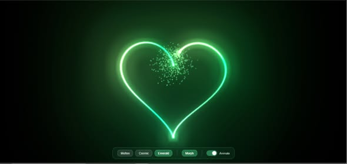
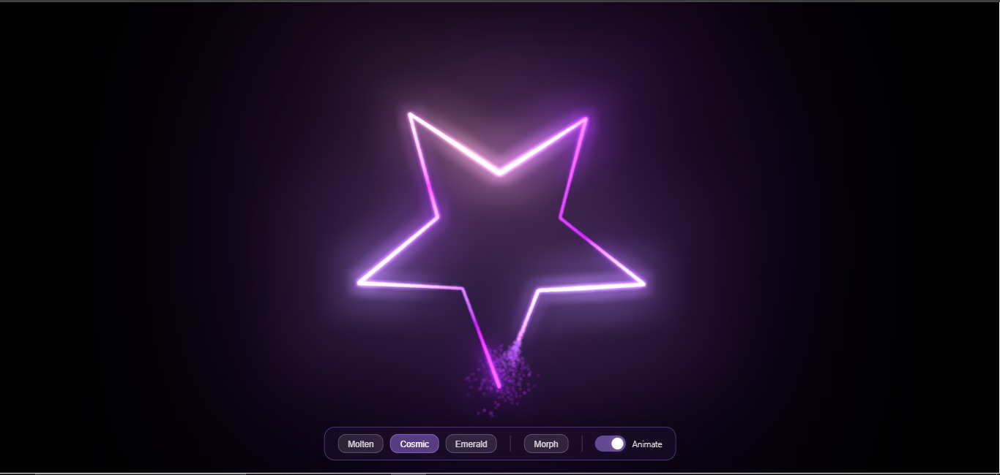

# Animation d'Anniversaire pour mes Cousines 🎉




Une belle animation interactive créée avec Three.js pour souhaiter un joyeux anniversaire à mes cousines. L'animation présente une transition fluide entre une étoile et un cœur, avec des effets de particules et de lumière.

Visuel en ligne : https://anaimationhbd.netlify.app/

## Fonctionnalités ✨

- Animation fluide entre une étoile et un cœur
- Système de particules dynamique
- Trois thèmes différents :
  - Molten (Rouge-Orange)
  - Cosmic (Violet)
  - Emerald (Vert)
- Contrôles interactifs :
  - Rotation de la caméra
  - Zoom avant/arrière
  - Activation/désactivation de l'animation
  - Changement de thèmes
  - Transition entre étoile et cœur

## Technologies Utilisées 🛠

- Three.js pour les graphiques 3D
- TypeScript pour un code robuste et typé
- HTML5 & CSS3
- Effets de post-processing (Bloom)

## Comment l'utiliser 🚀

1. Cloner le projet
2. Installer les dépendances :
   ```bash
   npm install
   ```
3. Lancer le serveur de développement :
   ```bash
   npm run dev
   ```
4. Ouvrir le navigateur à l'adresse indiquée (généralement http://localhost:3000)

## Contrôles 🎮

- Cliquer et faire glisser pour faire pivoter la vue
- Molette de la souris pour zoomer/dézoomer
- Boutons de thèmes pour changer les couleurs
- Bouton "Morph" pour basculer entre l'étoile et le cœur
- Interrupteur pour activer/désactiver l'animation

## Structure du Projet 📁

- `index.html` - Point d'entrée de l'application
- `script.ts` - Code principal TypeScript avec la logique d'animation
- `style.css` - Styles et animations CSS
- `dist/` - Fichiers JavaScript compilés

## Personnalisation 🎨

Vous pouvez facilement personnaliser l'animation en modifiant :
- Les couleurs des thèmes dans l'objet `themes`
- Le nombre de particules avec `particleCount`
- Les paramètres de bloom pour chaque thème
- Les formes en modifiant les fonctions `createStarPath` et `createHeartPath`

---

Créé avec ❤️ pour mes cousines